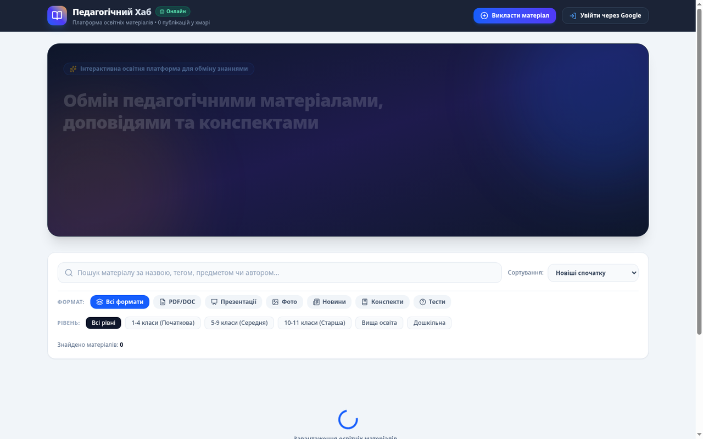

# Pedagogical Hub

A web platform for sharing educational materials between teachers, students and learners. Users can publish documents, presentations, photos and articles, discuss them in real time and save favourites.



## Features

- Google/Firebase authentication.
- Role selection for teachers, students and pupils.
- Interactive document, presentation, photo and article viewer.
- Comments and discussion threads.
- Likes and saved materials.
- Search and filtering by education level and content type.
- Firebase Firestore real-time data.

## Tech stack

- React 19
- TypeScript
- Vite
- Tailwind CSS
- Firebase Auth and Firestore
- Lucide React

## Quick start

```bash
npm install
cp .env.example .env
npm run dev
```

Fill `.env` with your Firebase client configuration, then open `http://localhost:3000`.

## Configuration

The project reads Firebase settings from environment variables:

```env
VITE_FIREBASE_API_KEY=
VITE_FIREBASE_AUTH_DOMAIN=
VITE_FIREBASE_PROJECT_ID=
VITE_FIREBASE_STORAGE_BUCKET=
VITE_FIREBASE_MESSAGING_SENDER_ID=
VITE_FIREBASE_APP_ID=
VITE_FIREBASE_DATABASE_ID=
```

Never commit `.env` or Firebase service-account files.

## License

This project is licensed under the [MIT License](LICENSE).

## Українською (коротко)

Pedagogical Hub — платформа для обміну педагогічними матеріалами між вчителями, студентами та учнями. Підтримує Google/Firebase авторизацію, ролі, перегляд документів/презентацій/фото, коментарі, вподобайки, пошук і фільтрацію. Запуск: `npm install`, налаштувати `.env`, потім `npm run dev`.